# Open Generative AI — Local Edition

**A desktop AI studio that runs on your own PC, and that your AI assistant can drive.** Generate and edit images, make video, lip-sync a portrait, direct "cinema" shots and **put a whole movie together (pictures, clips, titles, music and sound effects)** with no API key, no subscription and nothing leaving your machine. The app also runs a **local MCP server**, so Claude Code, Cursor or any MCP client can use your local models while the app is open.

> This is a fork of [Anil-matcha/Open-Generative-AI](https://github.com/Anil-matcha/Open-Generative-AI) (MIT). The original is a cloud studio; **this fork makes the local side the main thing**: new engines and models, a hardware check for every model, history that survives restarts, prompt translation, picture editing, a movie studio and a music tab. The upstream documentation (cloud models, hosted version, installers) is kept in [docs/original-project.md](docs/original-project.md).

<p align="center">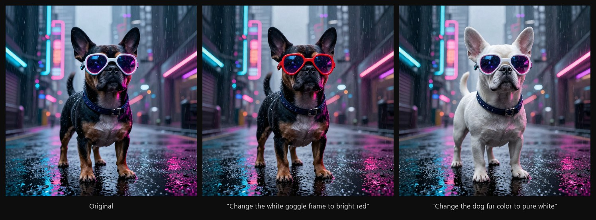</p>
<p align="center"><sub>Local image editing (Kroma Edit): one prompt each, the rest of the picture stays untouched. Generated on an RTX 4080.</sub></p>

## At a glance

- **Local first.** Image, Video, Lip Sync, Anime (H3), Movie, Music and Cinema all run on your GPU. Every local model is rated against your PC (*Recommended / Heavy / Won't fit*) before you download it.
- **Driveable with MCP.** The app is an MCP server on `127.0.0.1` (off by default, token protected). Your assistant can use all of it: images, video, lip sync, music, MiniMax H3 shots and the whole movie maker, with the models you already have, and the results appear in the app. [Details](#the-app-as-an-mcp-server).
- **A movie studio.** An AI director turns an idea and your own pictures into a finished video, with titles, 32 transitions, local music and sound effects and a final upscale. [Details](#make-a-whole-movie-from-your-own-pictures).
- **Your files stay yours.** History survives restarts, a **Folders** button opens the result folders, nothing is uploaded.

## Quick start (Windows)

Needs [Git](https://git-scm.com/) and [Node.js 18+](https://nodejs.org/). In PowerShell:

```powershell
git clone --recurse-submodules https://github.com/lelus78/open-generative-ai
cd open-generative-ai
powershell -ExecutionPolicy Bypass -File setup.ps1            # app only
powershell -ExecutionPolicy Bypass -File setup.ps1 -Wan2GP    # + Wan2GP for the larger image models, video and lip sync (NVIDIA GPU)
start.bat
```

Then open **Settings → Local Models**: install the sd.cpp engine (one click), optionally **Install automatically** next to Wan2GP, and switch any studio to **⚡ Local**. Models download the first time you use them, and the picker tells you the size beforehand. `-ModelsDir D:\AI\local-ai` (or *Change folder* in Settings) keeps the multi-GB files on another drive.

**Hardware.** sd.cpp runs on the CPU or most GPUs (Metal on Apple Silicon). Wan2GP needs an NVIDIA GPU: 12 GB of VRAM or more for Krea 2 / Kroma / HiDream, 8 GB for Ideogram v4 NF4 and the lighter models; plenty of RAM helps (the big models are quantized on the fly, 32–48 GB is comfortable). The first generation with a large model is slow because it is loaded, quantized and moved to the GPU once; the persistent server keeps it ready afterwards.

## The studios

<p align="center">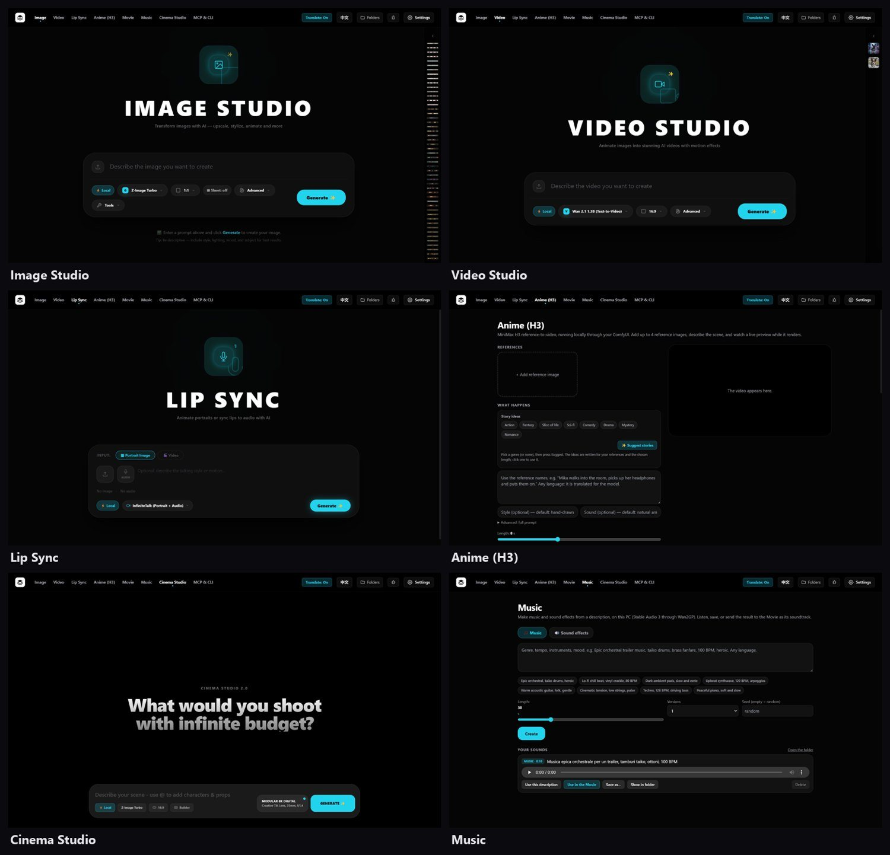</p>

| Studio | What it does locally |
|---|---|
| **Image** | Text to image and **edit a picture with a prompt**; style presets, any aspect ratio, prompt enhancer, history. |
| **Video** | Wan 2.1 / 2.2, FusioniX, Hunyuan 1.5 and LTX-2 through Wan2GP: text to video and image to video. |
| **Lip Sync** | A portrait and an audio file become a talking video (InfiniteTalk). Heavy: about 22 GB to download and best from 20 GB of VRAM, so it is optional (the app tells you if your PC can run it). |
| **Anime (H3)** | MiniMax H3 reference-to-video through your own ComfyUI: up to 4 reference pictures, a scene description, live preview. |
| **Movie** | The AI director, per-shot references, picture editor, titles, transitions, music, final upscale. |
| **Music** | Music and sound effects from a description, with Stable Audio 3. |
| **Cinema** | Camera and lens settings turned into a visual look, with any ready image model. |
| **MCP & CLI** | The local MCP server (URL, tools, token) and copy-paste setups for Claude, Cursor, Windsurf, Gemini CLI, Cline and any MCP client. |

## The app as an MCP server

Settings → Local Models → **Let AI assistants use this app (MCP)**. It is off by default; when on, the app listens on `127.0.0.1` only, needs a random token, and refuses browser requests. The settings show a ready command, for Claude Code:

```bash
claude mcp add --transport http open-generative-ai http://127.0.0.1:47821/mcp \
  --header "Authorization: Bearer <token shown in Settings>"
```

Then ask your assistant things like *"generate a fox in the snow at sunset"*, *"make the dog in /path/dog.png black"* or *"make a 15 second vertical reel from these three photos, with music, in Cinzel capitals"*. **The assistant can use the whole app**, not only the image studio, and what it makes shows up in the app while it works (a note says what it is doing, a project it builds can be opened in the Movie tab).

| Area | Tools |
|---|---|
| **Images** | `generate_image`, `edit_image`, `enhance_prompt`, `edit_picture` (crop, rotate, flip, brightness, contrast, colour) |
| **Video** | `generate_video` (text or picture to video), `make_lipsync` (portrait + audio), `h3_shot` (MiniMax H3 from reference pictures, also the Anime tab) |
| **Music and sound** | `generate_music`, `generate_sound_effect` |
| **Movie** | `movie_options` (transitions, styles, formats), `movie_storyboard` (the local writer), `movie_render` (scenes, captions, titles, transitions, music, fades), `movie_upscale`, `movie_title_clip` (transparent title), `movie_last_frame`, `movie_probe`, `movie_library`, `movie_open_in_app` |
| **Long jobs** | videos, shots and movies run as jobs: the tool waits a little and answers with a job id; `job_status` waits for it, `list_jobs` and `cancel_job` manage them. One engine runs at a time. |
| **The app itself** | `list_models` (what is ready, with the fit of your PC), `recent_results`, `show_folder`, `debug_log` (what each tool did and why a job failed), `cancel_generation` |

Only models that are already downloaded are used, so an assistant never starts a multi-GB download by itself.

**What to expect.** A heavy model is loaded into the GPU the first time it is used and again after the app has been idle (ComfyUI is stopped after 15 minutes unused), so the first video or shot after a pause can take several minutes, and a later one under a minute. While a big model loads or runs, the PC and the app can feel slow, as with any GPU job; the app stays usable, `cancel_job` stops a job, and only one engine runs at a time. Lip sync needs the 22 GB InfiniteTalk model: without it `make_lipsync` answers that no lip-sync model is ready and downloads nothing. The *MCP & CLI* tab shows the local server (URL, tools, a masked token) and ready setups for each client.

## Connect any AI client (MCP & CLI)

<p align="center">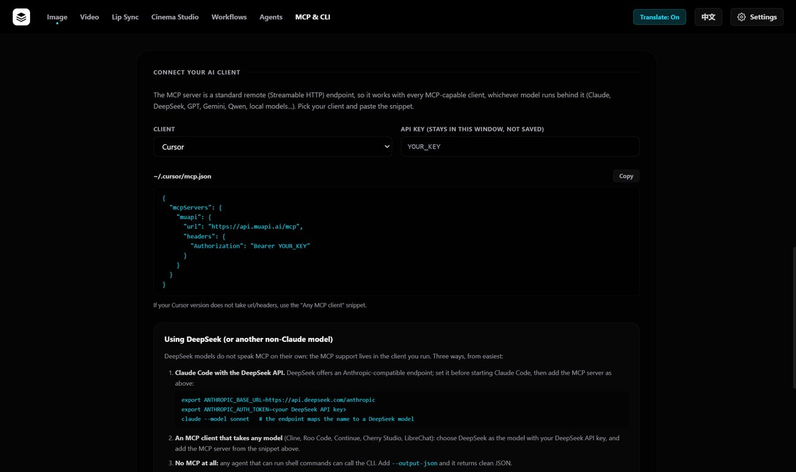</p>

## Make a whole movie from your own pictures

The **Movie** tab turns an idea (or a few photos) into a finished video, all on your PC. You can use it in two ways: describe the movie and let the AI director do everything, or arrange pictures and clips yourself and finish them with titles, transitions and music.

**1. Describe it, add the pictures that must look right.** The local writer (Qwen) turns the idea into shots. Pictures you add as *references* (an object, a place, a person) are what the video model (MiniMax H3) keeps faithful, so a real prop stays the real prop. Shots can be vertical (Reels, Shorts, TikTok), square or wide.

<p align="center">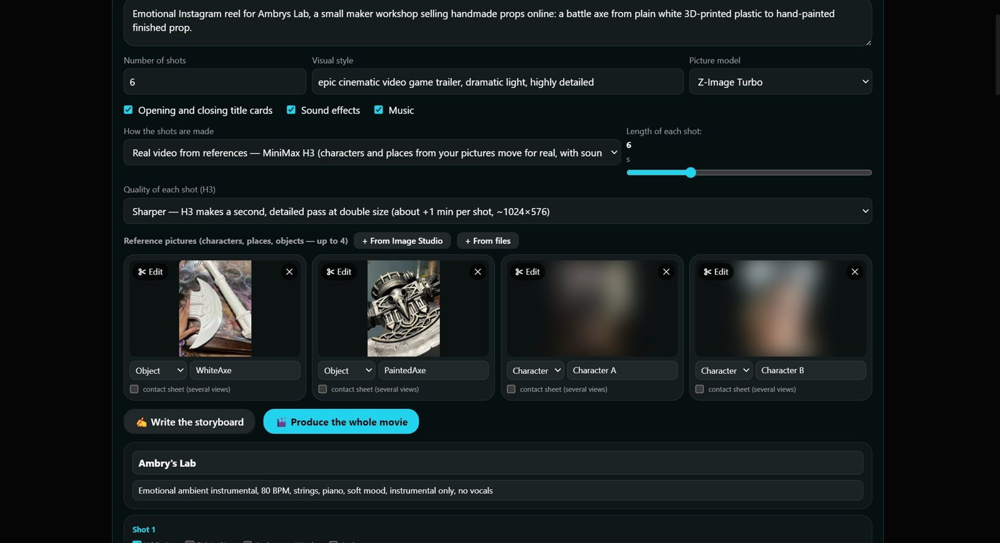</p>
<p align="center"><sub>The AI director: the idea, how long and how sharp each shot is, and the reference pictures (faces blurred here). <b>✂ Edit</b> opens the picture editor below.</sub></p>

**2. Each shot can be redone on its own.** Every shot shows the reference pictures it is made from: you can add, remove or edit them for that shot only (a face for the shots where it is seen, the whole object for the shot where only the object appears). The last three versions of a shot are kept, click one to use it. Titles and captions are chosen in the same place.

<p align="center">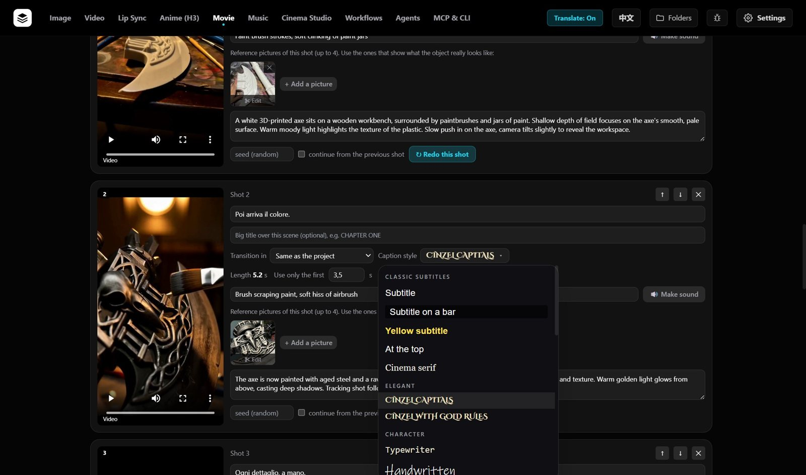</p>
<p align="center"><sub>One shot: its references, its description, <b>Redo this shot</b>, and the caption menu. Each style is shown in its own typeface and colour (28 title styles and 24 caption styles, grouped; the menu lists the ones whose font is on your PC).</sub></p>

**3. Edit a picture without leaving the app.** Crop (free or to a fixed shape), rotate, flip, brightness, contrast and colour, for example to cut a face out of a bigger photo and use it as a reference. The original is never changed: the app uses a saved copy.

<p align="center">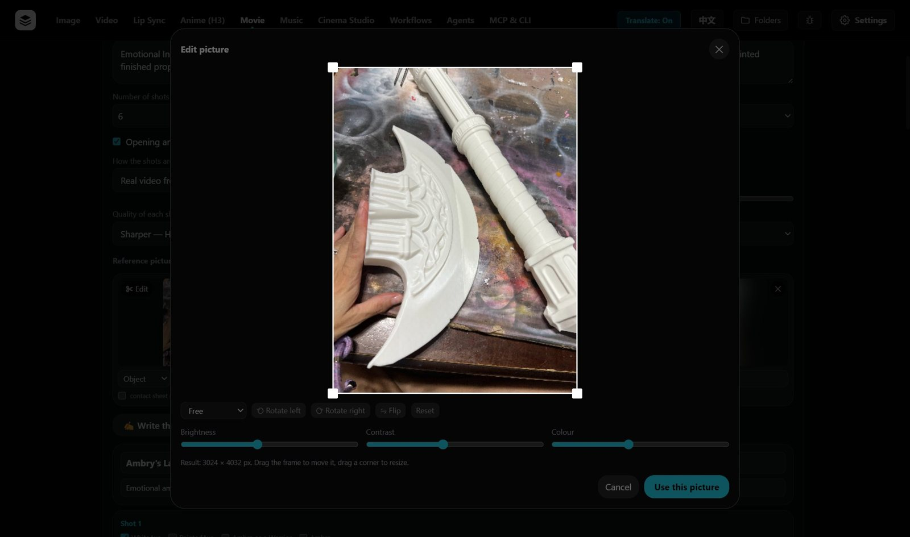</p>

**4. Music and sound effects, made on your PC.** The **Music** tab makes a soundtrack or a sound effect from a description (Stable Audio 3 through Wan2GP) and can send it to the movie. The director can also compose the music and the effects of a movie by itself.

<p align="center">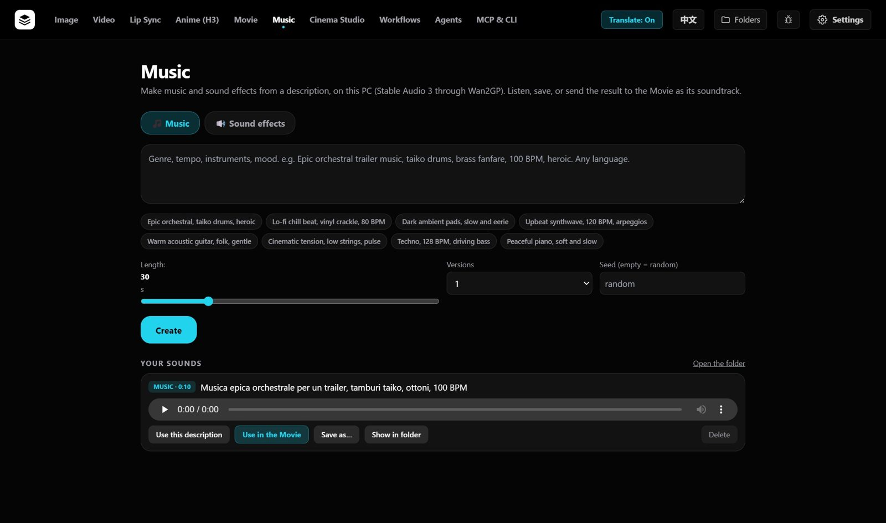</p>

**5. Put it together and make it bigger.** 32 transitions, titles and captions, optional title cards (also as a transparent video you can use in another editor), the sound of the clips and the music mixed, then a **final upscale** to Full HD, 2K or 4K (a fast one that keeps faces natural, or an AI one in ComfyUI).

<p align="center">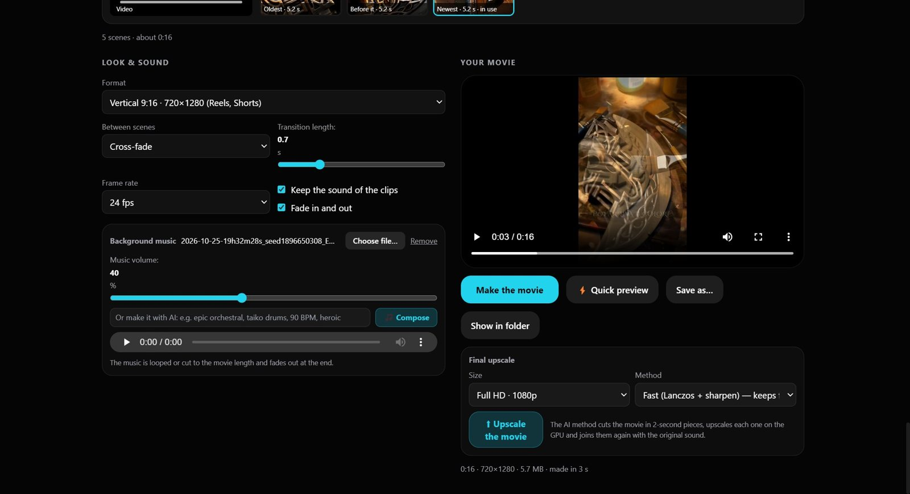</p>
<p align="center"><sub>Look &amp; sound, the finished movie and the <b>Final upscale</b>. <b>Show in folder</b> opens the folder with the result.</sub></p>

<p align="center">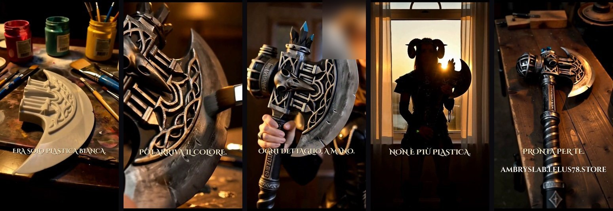</p>
<p align="center"><sub>A real result: a vertical Reel made from three photos of a hand-painted prop. The shots and the music were made by the app; titles and captions come from its styles (the person in the third frame is cropped and blurred).</sub></p>

What it needs: **ffmpeg** (the one that comes with Wan2GP is found automatically) for everything; **Wan2GP** for the music and sound effects; and, for shots made from reference pictures, **MiniMax H3 in your own ComfyUI folder** (the app asks for the folder and tells you which files are missing). Tips that came out of real use: show the **whole object** in a reference when the shot must show it all; for a shot with a person, give one clear face picture and name that person in the shot description; strong side light makes any face look older, so prefer soft light or a backlit silhouette.

## Models, history and settings

### Models that fit *your* PC
The picker rates every local model against the machine the app runs on, so you do not download 20 GB to find out it will not run. Green *Downloaded* means it is already on disk.

<p align="center">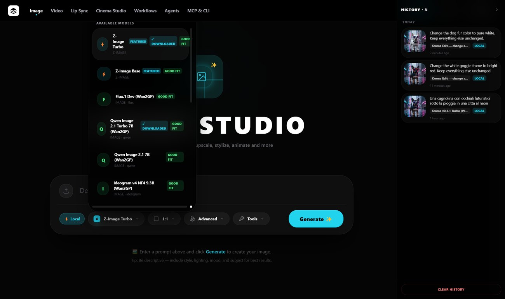</p>

Older families (SD 1.5, SDXL, Chroma) stay available but are listed last, with a **Legacy** label, when the GPU has 12 GB or more. On a 6–8 GB card they are the models you want, so they are not demoted there.

<p align="center">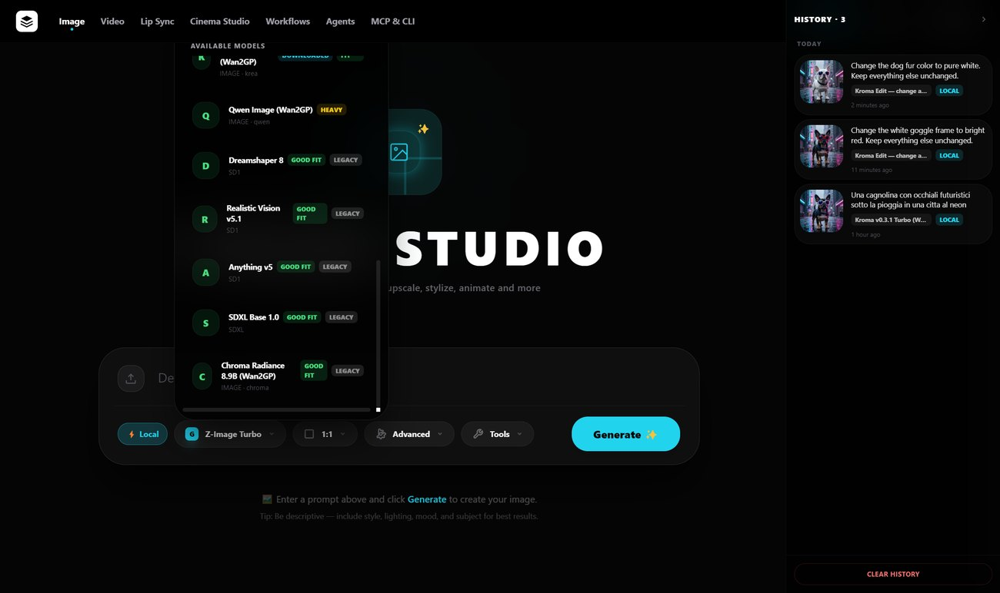</p>

### Edit an image with a prompt
Upload a picture in Image Studio with **⚡ Local** on: the list switches to the edit models (Kroma Edit, Krea 2 Turbo Edit General v2). Describe the change, keep everything else.

<p align="center">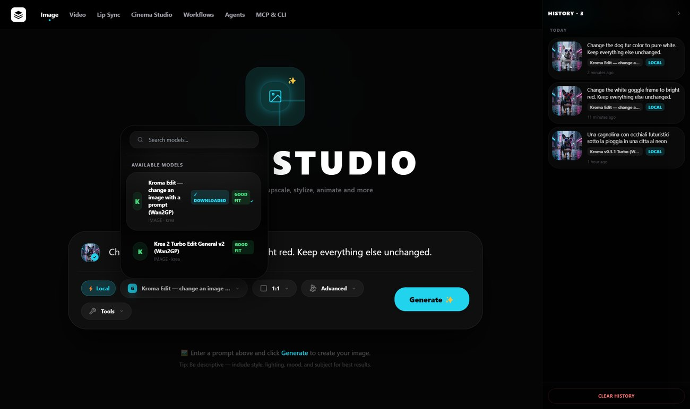</p>

### History that is still there tomorrow
Every result is kept with its prompt, model and time. Prompts typed in another language show the English translation that was actually used, and re-running a recovered prompt does not translate it again.

<p align="center">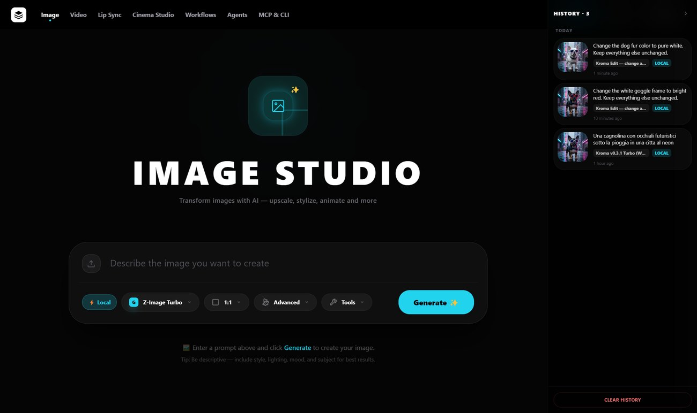</p>

### One place for local models
Settings → Local Models: your hardware, the Wan2GP install (one click), where the files go, the translation switch, the disk space used by generated files, and every model with its fit, its size and whether it is downloaded.

<p align="center">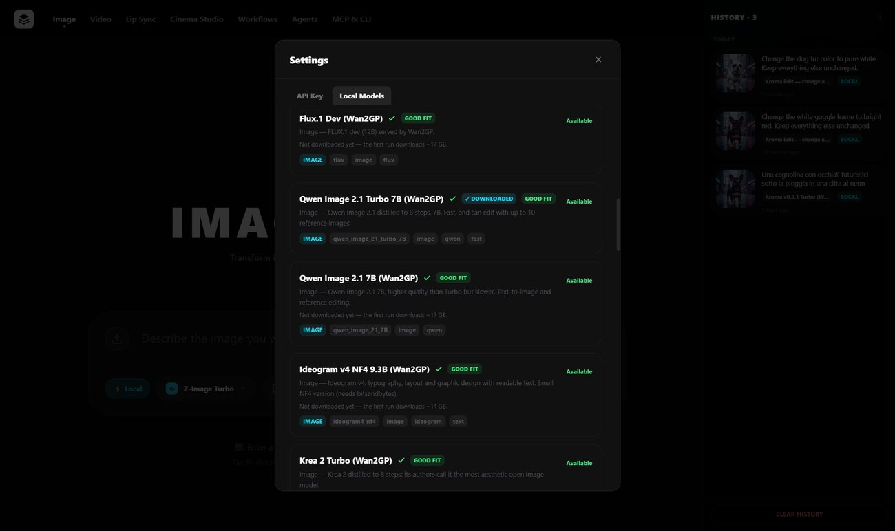</p>

## What this fork changes

| | Upstream | This fork |
|---|---|---|
| **Main idea** | A cloud studio with local inference as an add-on. | Local first: every studio can run on your PC. |
| **Local engines** | sd.cpp (image only); Wan2GP if you install it yourself. | sd.cpp **and** Wan2GP, with a **one-click Wan2GP install** (Python, PyTorch and Wan2GP, no git or conda needed). |
| **Choosing a model** | A flat list. | Each model is rated against the GPU, RAM and free disk of the PC running the app, with the reason and the download size. Older models are sorted last as *Legacy*. |
| **Editing a picture** | Not available locally. | **Image edit with a prompt**: the picture is kept, only the change is applied. |
| **Prompts** | Whatever you type. | **Local translation** to English (with an on/off button) and a **Prompt Enhancer** with a local LLM. |
| **Speed** | A new Wan2GP process per generation. | One **persistent Wan2GP server**: the first image loads the model, the next ones start at once (first edit about 8 minutes, the next one 37 seconds in my test). |
| **History** | Lost on restart for local images. | Survives restarts: thumbnails, search, day groups, recover a prompt, delete one or all (and the file). |
| **Movies and sound** | Not available. | Movie studio, Music tab, **Folders** button, **Debug** panel. |
| **AI assistants** | Not available. | A **local MCP server inside the app** that covers images, video, music and the movie maker. |

## What else changed

- **Image Studio:** style presets now really change the prompt; any aspect ratio is supported locally (it was five fixed presets); the Prompt Enhancer builds on the prompt you already typed instead of replacing it; the optional **✨ Enhance with AI** expands it with the local Qwen model.
- **Video Studio:** Wan 2.1 / 2.2, FusioniX, Hunyuan 1.5 (480p, 720p, image-to-video) and LTX-2 via Wan2GP, each described in the list with what it is good for.
- **Lip Sync Studio:** portrait + audio → talking video with InfiniteTalk, locally.
- **Cinema Studio:** local mode with any ready image model; camera and lens settings are turned into a *visual look* instead of drawing a photographer holding a camera.
- **Movie, Music, Anime (H3):** a movie studio with an AI director, a music and sound-effects tab, a studio for MiniMax H3 anime clips, a **Folders** button for every result folder and a **Debug** panel that shows what each tool did and why something failed.
- **Downloads:** guard against two downloads of the same file (which produced white images from a corrupted model), size check after every download, and a clear progress label (downloading, translating, loading, step n/N).
- **Files:** every result can be deleted from the history (the file goes too); Settings shows the disk used and has *Delete all*. The model/output folder can be changed from the app.
- **Windows setup:** `setup.ps1` and `start.bat` install and start everything; `scripts/install-wan2gp.ps1` installs Wan2GP from a terminal.

## Local models at a glance

| Model | Engine | Use |
|---|---|---|
| Z-Image Turbo / Base | sd.cpp | Fast, high-quality images; the Qwen3 text encoder it downloads also powers translation and the enhancer |
| SD 1.5 (Dreamshaper, Realistic Vision, Anything), SDXL | sd.cpp | Light models for 6–8 GB GPUs (listed as *Legacy* on stronger PCs) |
| Qwen Image, Qwen Image 2.1 (7B, Turbo), Flux.1 Dev | Wan2GP | General image generation |
| Ideogram v4 NF4 | Wan2GP | Typography and layouts with readable text |
| Krea 2 Turbo, [Kroma](https://huggingface.co/lodestones/Kroma) v0.3.1, HiDream O1 | Wan2GP | Aesthetic images; Kroma is a Krea 2 finetune (bundled as a Wan2GP finetune definition) |
| Kroma Edit, Krea 2 Turbo Edit General v2 | Wan2GP | **Edit an uploaded picture with a prompt** (Kroma Edit reuses the Kroma download) |
| Wan 2.1 / 2.2, FusioniX, Hunyuan Video 1.5, LTX-2 | Wan2GP | Text-to-video and image-to-video |
| InfiniteTalk | Wan2GP | Lip sync from a portrait and an audio file |

Each model's licence is its own; none of the weights are in this repository.

## How it works

- **Electron** main process runs the engines (`electron/lib/`): the bundled **sd.cpp** CLI, **Wan2GP** (`wgp.py`, kept alive as a local MCP server between generations), and a small **llama.cpp** helper for translation and the enhancer. The UI (Vite, vanilla JS) talks to them through `window.localAI`.
- A **hardware profile** (GPU, VRAM, RAM, free disk) feeds `wan2gpFit.js`, which rates each model; the same rating decides sorting, blocking and the *Legacy* demotion.
- Results are saved in the local-AI data folder next to the models and referenced from the history, so deleting a result deletes its file.
- Model catalogs live in `electron/lib/wan2gpCatalog.js` and `src/lib/localModels.js` (kept in step by tests), extra model definitions in `electron/finetunes/`. The unit tests run with `node --test tests/*.test.js`.

## Cloud models (optional)

The upstream project also works with cloud models through an API key (Settings → *API Key (optional)*). That path is not what this fork is about and is not needed for anything above; its documentation, the hosted version and the desktop installers are in [docs/original-project.md](docs/original-project.md).

## Credits

Built on [Open-Generative-AI](https://github.com/Anil-matcha/Open-Generative-AI) by Anil Matcha and contributors (MIT), [stable-diffusion.cpp](https://github.com/leejet/stable-diffusion.cpp), [Wan2GP](https://github.com/deepbeepmeep/Wan2GP), [llama.cpp](https://github.com/ggml-org/llama.cpp), and the authors of the models listed above.
